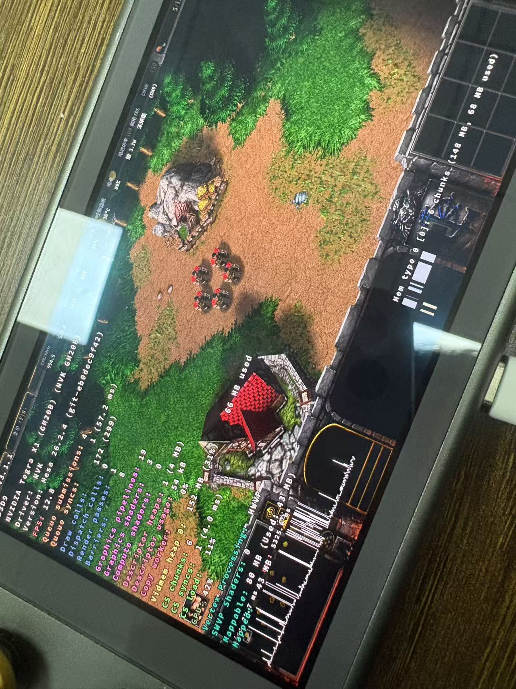

# Switch Lite game runs — 2026-11-27

PAL4 (Chinese Paladin 4 / 仙剑奇侠传四) now starts and reaches a game
scene on the tested Windows 11 ARM64 Switch Lite. Warcraft III also reaches
a map and renders through Mesa NVK on GM20B. Frame rates still need work;
these observations do not establish satisfactory gameplay performance or a
new accepted driver baseline.

## Observed results

| Game | Result | Remaining work |
| --- | --- | --- |
| PAL4, Chinese voice edition | The owner reported that startup, movie playback and a game scene work after the paging compatibility fix. The game log reaches `PALIV_SCENE`. | Movies and gameplay are very slow. Game audio is absent although desktop audio works. Recheck performance after removing the configuration's 10 FPS cap. |
| Warcraft III | The owner entered a map. The original photo below shows the map and the NVK / GM20B HUD, at approximately 12 FPS. | Locate the performance bottleneck. A usable map-time CPU/GPU trace and repeatable frame-time measurements have not yet been captured. |

This is the owner's original, unmodified photograph. SHA-256:
`1c1aa2a31e584c46db05f1a8086955f1757ab894dc340f97b6ef91ea2aacb24e`.
The HUD reports Mesa 26.2.4 / NVK and approximately 12 FPS; the visible GPU
load is about 11%. These are readings in one photograph, not an average or a
controlled benchmark. They demonstrate that Warcraft III is using the NVK
GPU rendering path. Low reported GPU load does not distinguish CPU
emulation, Direct3D translation, synchronization, presentation, NVK or KMD
overhead by itself. The game process's complete loaded-DLL hashes still
need a separate capture; DWM's loaded modules cannot substitute for them.

## PAL4 startup fix and evidence

The diagnostic KMD captured a rejected GPU-physical page-directory update:
`PageTableLevel=1`, `UpdateMode=2`, `hAllocation=NULL`, and
`DriverProtection=0xfe`. The two-level page table was already implemented.
The fix accepts this already-supported leaf kind when Windows carries it
on a GPU-physical directory update, while the directory entry still encodes
only the child-table pointer. It retains `PageTableLevelCount = 2`, the
kind whitelist, the CPU initialization restriction and the existing bounds
and ownership checks.

The same real-WDK paging test failed with the old implementation and passed
with the fix on the Switch. The signed ARM64 diagnostic KMD reached device
Code 0 using a consumed one-use permit. The owner's subsequent PAL4 run
reached the game scene. See the [captured parameters, component hashes and
before/after tests](../LITE_PAL4_PDE_KIND_20261127.json).

The KMD used for that run has SHA-256
`1f556e56024818b4b0b2715f32aae2a77413f4d768d6bd41d038648bc012623c`.
Its functional source is commit
`44e9bac92bcea8f030865cc853b129105cf92b63`. This is a one-use diagnostic
candidate, not a permanently authorized daily package. The startup fault
remains recorded in [the fault ledger](../open-faults.json) pending the
required acceptance and promotion evidence.

## Performance and audio investigation

- PAL4's `dxvk.conf` contained `dxvk.maxFrameRate = 10`. It was backed up
  and changed to `0` after the game exited. This removes that explicit cap
  on the next launch; improvement has not yet been measured. The existing
  single compiler thread and descriptor-buffer settings were left intact.
- An approximately eight-second PAL4 sample used 74% of one CPU core in
  aggregate (71.7% user time, 2.3% kernel time). This is not 74% of the
  whole four-core CPU, and the sample contains no call-stack attribution.
- PAL4 uses Bink 1.5t and Miles Sound System 6.5c. Its Bink movie path has
  not been connected to this project's H.264 D3D11VA/NVDEC decoder. A
  separate successful H.264 test is not evidence of Bink hardware decoding.
- Desktop audio works, and PAL4 reports successful audio initialization,
  but the owner hears no game audio. Device selection, mixing and the
  game's audio path remain to be checked.
- Warcraft III exited before the attempted remote performance sample.
  That empty sample cannot establish zero GPU use or a game hotspot. The
  photograph supplies rendering evidence, but not a synchronized trace.

Next measurements should separate Windows x86 translation, DXVK's D3D9
translation and waits, NVK submission and shader work, KMD scheduling and
presentation, and actual GPU execution. Use a repeatable map/scene, record
frame times and CPU stacks together, and bind results to the actual loaded
game DLL paths and SHA-256 values. Until then, the cause is **unresolved:
translation overhead versus driver performance**; more than one layer may
contribute.

These results apply to the tested Lite and component combination. They do
not claim OLED validation, general game compatibility, full audio/input
acceptance, or completion of the baseline promotion checks.

## Scoped daily baseline follow-up

The directory-kind repair was subsequently qualified in a separate daily KMD
(`1d88065b2e4a`) with bounded diagnostics and the active stop probe disabled.
The guarded policy granted permanent startup, and boot 106579 verified Code 0
and the exact native component hashes. The original forced-stop diagnostic
image described above was not promoted. This scoped repair does not resolve
PAL4 audio or either game's frame-rate limitations.
[Daily qualification and permanent-boot evidence](../pal4-pde-kind-daily-20261127/README.md).
